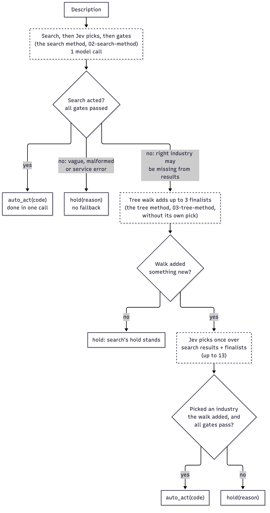

# Design

## The problem

An insurance application asks for the applicant's NAICS code. Applicants often don't know it, write
an old or wrong one, or describe their business in words the official Census text never uses
("boba shop", "gig driving", "CrossFit box"). The classifier reads the description of operations and
either names one NAICS 2022 industry or hands the case to a person with a reason.

## Principles

- **Code owns the actuators.** Jev never emits free text. Every Jev question is a Choice over a
  closed list of real industries, or a Noul (a probability that something is true). Code builds the
  list, checks every answer, and decides whether to act or hold.
- **Find, then judge.** Retrieval narrows 1,012 industries to a handful in code (search or the tree
  walk). Jev judges only that handful, with each industry's official description, examples, index
  entries, and what the Census says it is not.
- **Gates fail closed.** Gates check the chosen option's probability, never Choice confidence. A NaN,
  out-of-range, or missing answer holds; so does a service error.
- **Thresholds are measured.** Every threshold lives in `questions.py` with a comment on how it was
  calibrated on the pinned model. Changing the model pin means re-measuring first.
- **Replay never invents.** Offline tests and CI answer from transcripts recorded on the real model. A
  missing recording raises.


## The three methods

### search (find, then judge)

1. **Search (code, no model call).** Postgres full-text search over the Census text, weighted: title
   (A); index entries, examples and the activities other industries send here (B); the description
   (C). Words rank by rarity (IDF), so "grooming" outweighs "services". Before searching, code corrects
   typos to the nearest Census word (trigram similarity plus edit distance; a correction counts at half
   weight) and reads a reviewed list of 27 modern terms ("SaaS", "telehealth", "ghost kitchen") as
   Census wording (at a quarter weight). Top 10 results.
2. **Judge (one Jev call).** A Choice over those 10 industries; a fit Noul for each ("does this
   industry describe the primary activity?"); and a vagueness Noul.
3. **Decide (code).** Act only when the pick's probability is at least 0.70, its fit is at least 0.50,
   and the vagueness Noul is under 0.70. Otherwise hold with the reason. A single search result also
   holds: there is nothing to compare it with.

### tree (reason down the taxonomy)

1. From the root, one Jev call per level asks each kept node "which of your children fits?", for every
   open path at once. The walk keeps the 3 best paths by the geometric mean of their probabilities, and
   skips any node with a single child.
2. The paths' end points (up to 3 industries) get one final Choice with their descriptions and index
   terms, plus a fit Noul each.
3. The same gates as search.

The walk needs no word overlap, so it handles modern wording and typos. But an early wrong turn is
hard to recover from: NAICS files veterinary clinics under professional services, not health care.

### hybrid (search first, the tree walk as a fallback)



1. Run search. If it acts, that is the answer: one call.
2. Only when search holds because the right industry may be missing from its results (no match, low
   probability, misfit), run the tree walk to its finalists, with no pick of its own.
3. The finalists the walk adds join search's results, and Jev picks once over all of them (up to 13)
   with search's questions and gates.
4. **Only an industry the walk added can be acted on.** If the walk adds nothing new, or the pick lands
   on an industry search already offered and held on, search's hold stands. Asking a near-identical
   question twice is not new evidence.
5. A vague description, a malformed answer and a service error never fall back. The walk's own
   vagueness check still holds.

On the blind held-out set, search alone found the right industry in its top 10 for only 8 of 16
descriptions. The fallback rescued 7 of the other 8, each with an industry the walk added.

### refine (experimental: wide pick, then verify; `/v1/refine/assist`)

Built and measured in `experiments/EXPERIMENT.md` (E9 to E16). It is a fourth method, not a replacement: nothing above changed.

0. **Read the wording (code, no model call).** `lexicon.py` reads the text against a reviewed list of terms and
   abbreviations the Census text lacks ("SaaS", "HVAC", "dropshipping"). A term maps to Census wording, never to a
   code. A recognised term is always checked, even as a single word; its Census wording is appended after the user's own
   words only when the description is 6 words or fewer (a longer text already has its own context, and the added words
   once made a soybean farm that mentions a podcast read as two activities). The result reports what was read. Text with
   no listed term reaches Jev exactly as typed. The list is a draft no person has reviewed; its source can be a table in
   its own database (`lexicon.sql`), never the Census tables.
1. **Wide pick (one Jev call).** The completeness checks (operations, specific activity, one main activity), a
   sector-group Choice, and one Choice per block of sector groups (at most 240 options each) over a short profile of
   all 1,012 industries. Nothing is pruned early. If the text is not operations, not specific, or too vague, it stops
   here: `NEEDS_INFO`, one call, never a code. There is no word-count gate: only a single character is too short.
2. **Verify (one Jev call).** The best four industries, shown with their Census description (and, in the
   `cascadeb` variant, what each is not), get a Choice and a fit Noul. The gate is the same shape as search's:
   probability at least 0.70, fit at least 0.50, one main activity at least 0.50 (re-measured on this step in
   CALIBRATION.md). A hold or a pick-list follows otherwise.
3. **Score step (only when verify does not code).** Up to ten candidates (each block's best two) get a 3-level Score
   (different / related / primary) and the pick asked in both option orders. Exactly one "primary" and both orders
   agreeing is a code; two or more is a pick-list; none is a partial level or a hold. A Score answer that is not a
   distribution is a malformed answer (ERROR).

Cost: 2.3 Jev calls per description against about 5 for the tree-walk assist, but about 45k input and 13k output tokens
per call (the wide call carries every industry). What the evidence supports and what it does not is in
"Testing", below.

## Holds

| Hold | Meaning |
|---|---|
| `too_vague` | The description is too vague, or mixes unrelated businesses |
| `low_probability` | The pick is under the bar, or there was only one candidate |
| `misfit` | Jev's best industry does not describe this business |
| `no_match` | Search found no industry whose official words match (search only) |
| `invalid_answer` | An answer was missing, NaN, or out of range |
| `service_error` | The database, TypeSafe, or a recording was unavailable |

A hold carries no code. The industry Jev leaned to is reported as a diagnostic only. On the page, a
hold's path is greyed and labelled "not the answer", its candidate list is titled "Candidates it
considered (none chosen)", and its probabilities are labelled "lean", so a percentage under a hold
does not read as confidence in a pick (`frontend/js/labels.js`).

## Testing

Every claim is in `experiments/EXPERIMENT.md`; this is the summary and its limits.

- **Synthetic sets with a gold code** (dev, tech-enabled pairs, short/modern language, held-out; written from the
  Census text, the held-out ones by a separate agent). Used to build the method, so they are calibration sets now.
- **ExioNAICS** (public Hugging Face dataset, 13,669 distinct descriptions, local only). Its labels are about 30%
  wrong, so a code matches if it is any of the description's labelled codes, and every other code is judged blind by
  reviewers reading the Census text. On 2,000 descriptions refine gave 1,016 usable codes (label match or defensible)
  against 957 for the tree-walk assist, about 0.5% indefensible (6 of 1,192; assist 7 of 1,138), and 2.3 calls against
  5.1. 32% of those descriptions ended in a pick-list.
- **Not met, and not claimed:** PEAS's "wrong auto-act: never" is met by neither method (about 0.5% of codes are judged
  indefensible, 14% arguable); the reviewers are models, not underwriters; no broker has answered a pick-list.
- **Blind sets** are written before the method, then run once; the ones used so far were run many times and used to
  choose settings, so the final configuration has a fresh blind set (`refine_v2_*`) run once.

## Data flow

```
Census files (data/census-2022) --build_tree.py--> naics_2022_tree.json   (the tree walk)
                                --build_search.py-> naics_2022_search.json --db/build--> Postgres (search)
description -> [search | tree | hybrid] -> Jev (TypeSafe) -> code gates -> auto_act(code) | hold(reason)
```

## Separation

- **db:** Postgres only. It holds data derived from public Census text; no client data is ever stored.
  Its migrations live in the installed package (`backend/src/jev_naics/migrations/`), not in `db/`,
  so anyone who installs the `jev_naics` library can migrate a database without this checkout; `db/`
  holds only `load.sql` (a hand-written, Python-free mirror of the same load) and a pointer.
- **backend:** the library and the API. Every environment variable it reads: `TYPESAFE_API_KEY`
  (the TypeSafe credential) and `NAICS_DATABASE_URL` (the Postgres connection) from the process
  environment or a git-ignored `.env`; `NAICS_HOST` (the bind address, default `127.0.0.1`) and
  `NAICS_WEB_ORIGIN` (the single CORS-allowed origin, default `http://127.0.0.1:8097`, never a
  wildcard) as deployment settings Compose sets; `NAICS_MIGRATE_ON_START` (default `true`; `false`
  in Compose and production, where the one-shot `db_cli build` job builds the database and
  `/v1/health` answers 503 until it is ready — DEPLOY.md); and `JEV_DECIDER` (`jev`, `record`,
  `record-missing`, or `replay`) selecting how the decider answers Jev questions. Nothing else.
  API routes are versioned under `/v1` (`/v1/classify`, `/v1/naics/...`); the same routes are
  also served unversioned, marked deprecated, for one release.
- **frontend:** static files, its own nginx container. It calls the API at a configured base URL
  (`frontend/js/config.js`'s `JEV_NAICS_API`), holds no key, and makes no model call.
  `frontend/nginx.conf`'s Content-Security-Policy `connect-src` must name that same API origin, or
  the browser blocks the page's own calls to the API. The image keeps the two together: one
  variable, `NAICS_API_ORIGIN`, is written into `config.js` and rendered into the CSP at container
  start (`frontend/docker/15-naics-api-origin.sh`; JEV-56), and a malformed origin stops the
  container.

## Out of scope

Hosting (DEPLOY.md describes one way), rate limiting, NAICS years other than 2022 (a 2017 code is mapped to 2022 as a lookup
only), and custom class codes (designed in [docs/CUSTOM_CLASS_CODES.md](docs/CUSTOM_CLASS_CODES.md),
not built).
