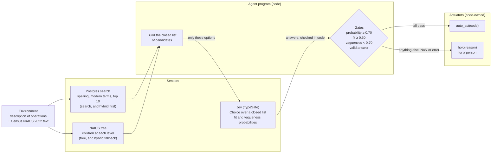

# PEAS: the NAICS classifier as an agent

PEAS stays the architecture; Jev fills only the "pick from a closed set" step, and code owns every
actuator.

## The agent at a glance

Jev is a sensor, not the agent: it answers over a list code built, and code decides whether to act.
Hold is never an option Jev can choose.

## Performance

Targets below are the spec. **Status (refine, 2026-10-07):** right code on an auto-act is measured against gold only on
synthetic sets; on 2,000 external descriptions about 85% of the codes are a dataset label or judged defensible, 14%
arguable, 0.5% indefensible. "Never" is not met (neither is it by the tree-walk assist). See DESIGN.md "Testing".

| Measure | Target |
|---|---|
| Right code on an auto-act | The gold NAICS 2022 industry |
| Correct hold | Holds when the fixture expects a hold (too vague, or several unrelated businesses) |
| **Wrong auto-act** | **Never**: a hold costs a person a minute; a wrong code misprices a policy without anyone noticing |
| Cost | Jev calls per description (1 when search is sure) |

Evals are strict: a hold passes only when the fixture expects one. Blind held-out sets are written by
a separate agent, committed before the method they test, and run once.

## Environment

The description of operations as typed, and the official Census NAICS 2022 text.

- **Partially observable:** only the description is seen, not the business itself.
- **Stochastic:** the model's answers vary slightly between runs.
- **Episodic:** each description is classified on its own.
- **Static:** the Census data changes only with a new NAICS edition.
- **Discrete:** exactly 1,012 industries, or a hold.

## Actuators (code-owned)

| Actuator | When |
|---|---|
| `auto_act(code)` | Every gate passed: the pick's probability, its fit, the vagueness check, and a valid answer |
| `hold(reason)` | Anything else, with one of: too_vague, low_probability, misfit, no_match, invalid_answer, service_error |

There is no free-text code and no "closest match" outside the candidates. None-of-the-above is a hold
that code decides; it is never an option Jev chooses.

## Sensors

- **The description** (text).
- **Search** (Postgres full-text search, spelling correction, modern-term reading): the candidates.
- **The NAICS tree** (2,126 nodes): the children offered at each level of the walk.
- **Jev (TypeSafe):**
  - a Choice over the candidates or a node's children;
  - a fit Noul per candidate;
  - a vagueness Noul.

## Refine (experimental): sensors added before and around Jev

| Part | What it is |
|---|---|
| Sensor (code) | **Lexicon reading** (`lexicon.py`): terms and abbreviations people use that the Census text lacks, read before Jev; maps to Census wording, never to a code; a recognised term lets a one-word description be checked |
| Sensor (Jev) | The completeness checks, a sector-group Choice, and Choices over all 1,012 industries' short profiles (the wide pick) |
| Sensor (Jev) | Verify: a Choice and fit Noul over the best four, with their Census text; then, only if it does not code, a 3-level Score per candidate and the pick in both option orders |
| Gates (code) | Probability 0.70, fit 0.50, one main activity 0.50 (measured on this step); exactly one "primary" and both orders agreeing; a malformed answer is ERROR |
| Actuators | Unchanged: `emit_naics_code`, `hold`; plus the code-owned tooltip and pick-list on the assist page |

The lexicon is the only place wording is added for Jev, it is reported back to the user (`reading`), and it is a draft no
person has reviewed.

## What Jev is never offered

Codes outside the candidate list, a "hold" or "none" option, or free text. Every Choice is built from
the Census data in code, and every answer is checked against the options it was given before it is
used.
