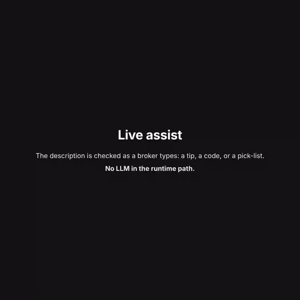
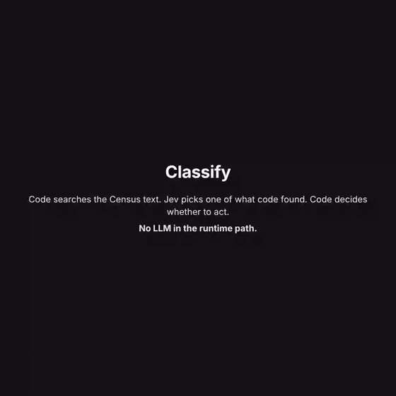
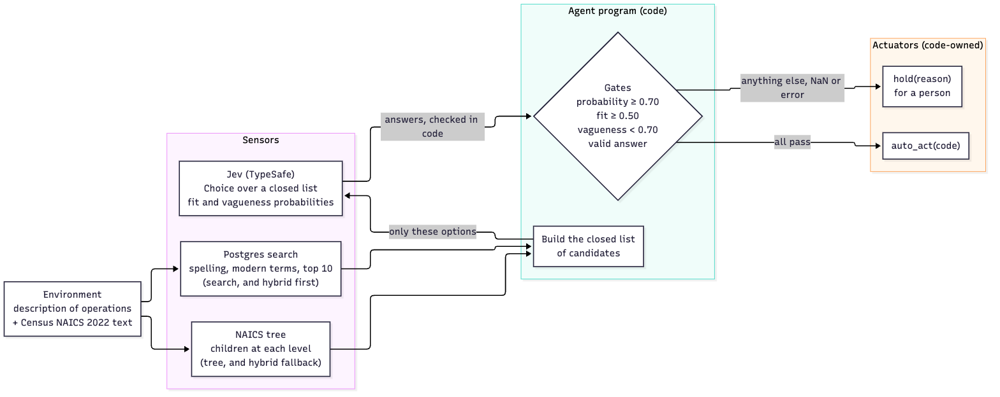

# jev_naics

[](https://github.com/jmurray10/jev_naics/actions/workflows/tests.yml)
[](LICENSE)
[](backend/pyproject.toml)
[](DATA.md)
[](#measured)
[](#what-runs-without-a-key)

Classify a business's **description of operations** into one of the 1,012 **NAICS 2022** industries,
or hold it for a person. Built for completing insurance applications, where the NAICS code routes
the submission to an appetite and a rating class, and a wrong neighbouring code misprices the risk
without anyone noticing.

**There is no LLM in the runtime path.** The agent is specified as PEAS (performance, environment,
actuators, sensors; see [PEAS.md](PEAS.md)), and code does almost all of the work: Postgres full-text
search over the official Census text, spelling correction, a lexicon of modern business terms, a walk
down the NAICS tree, every gate, and every hold. The one judgment, choosing among a short list of real
industries that code built, goes to [TypeSafe Jev](https://docs.typesafe.ai), a non-generative model
that answers typed questions (pick one of these options; is this statement true) with probabilities
and never writes text. It cannot invent a code, because it is never offered one. It cannot choose
"none of the above", because that is not an option either: a hold is an actuator that code owns.

[](docs/media/demo.mp4)

**Live assist:** the description is checked as a broker types. Too general gets one fixed tip on what
to add, specific enough gets a code from the tree walk, and two codes people often confuse get a
pick-list instead of a guess. The model only answers yes/no checks and closed choices; code owns
the status and every word of the tip.

| Classify | Short, modern wording |
|---|---|
| [](docs/media/demo.mp4) | [](docs/media/demo.mp4) |
| Search narrows 1,012 industries to 10 with no model call; Jev picks one; code decides whether to act. | "SaaS" is read as Census wording before the model sees it; the lexicon maps words, never codes. |

**[Watch the full demo video (69 s, MP4)](docs/media/demo.mp4)**: all three, end to end.

*Recorded in replay mode: every answer shown is a real Jev answer recorded on jev-1.13.0, replayed
from `backend/transcripts/`. Re-record any of them with `tools/record_demo.py` (`--videos all` writes the
clips, their GIFs, and the full video; copy them into `docs/media/`).*

## How it classifies

Three methods, one set of gates (see [DESIGN.md](DESIGN.md)):

| Method | What it does | Jev calls |
|---|---|---|
| **hybrid** (recommended) | Search first; only when search holds, the tree walk adds its finalists and Jev picks once over both | 1, or about 7 on a fallback |
| search | Postgres full-text search of the official Census text, then Jev picks among the top 10 | 1 |
| tree | Jev walks the NAICS tree from the 20 sectors down, keeping the 3 best paths, then picks among the finalists | about 5 |

The API and the page call the tree walk `full` (`mode: "full"`); the library and this README call
it `tree` (`method="tree"`). The API accepts both spellings for it, and the response's `mode` field
echoes whichever one was sent.

Every method holds for a person when the description is too vague, when the pick is under the
probability bar, or when the picked industry fails its fit check. It never writes a wrong code to
avoid a hold. Gates check the picked industry's probability and fit, never the model's own
confidence, and a missing, NaN, or out-of-range answer holds.

**Live assist** (the page's second tab, `POST /v1/assist`): as a broker types, each pause runs
yes/no checks (does the text say what the business does, specifically enough, with one main
activity) and the tree walk, and code turns the answers into a status: `CODED`, `PARTIAL` (an
industry group or sector), `AMBIGUOUS` (a pick-list between codes that are commonly confused),
`NEEDS_INFO` with one fixed tip on what to add, or `ERROR`. It never blocks a submission and never
writes text. Bars and their measurements: CALIBRATION.md, "Real-time assist".



New to this? [Follow one description from typing to answer](docs/diagrams/06-one-description-end-to-end.png).
More pictures of each method and the data flow are in [docs/diagrams/](docs/diagrams/README.md).

## What runs without a key

Two different keys are involved. `TYPESAFE_API_KEY` lets the code call Jev live; without it, the
code replays answers recorded on the real model, and a description that was never recorded is
refused rather than guessed (the library holds it with `service_error`; the API answers 409).
`NAICS_API_KEYS` are the API's own service keys (see "Service keys" below).

| Without a TypeSafe key | With `TYPESAFE_API_KEY` |
|---|---|
| The full test suite and every eval, replayed from `backend/transcripts/` | Classify or assist on any description live |
| The page's examples and every recorded description, on both tabs | Re-record transcripts (`JEV_DECIDER=record`) |
| Search the Census text: `GET /v1/naics/search`, `GET /v1/naics?q=` (no model) | Re-measure thresholds on a new model pin (CALIBRATION.md) |
| Browse the tree and export the reference data (no model, no database) | |
| Build and verify the Postgres search database | |

TypeSafe's API is in early access; see [docs.typesafe.ai](https://docs.typesafe.ai).

## Measured

Live on the pinned Jev model (jev-1.13.0), 2026-09-29. The blind held-out set was written and
committed by a separate agent before the hybrid existed, and run once.

| Set | Search | Tree walk | **Hybrid** |
|---|---|---|---|
| **Blind held-out** (16: taxonomy quirks, modern wording, typos, several activities) | 8 right, 8 held | 14 right, 2 held | **15 right, 1 held** |
| Dev (33) | 32 right, 1 correct hold | 30 right, 1 correct hold, 2 held | 32 right, 1 correct hold |
| Messy dev (18: typos, jargon) | 18 right | 17 right, 1 held | 18 right |
| **Wrong codes** | 0 | 0 | 0 |

On the blind set the hybrid used 56 Jev calls for 16 descriptions (search is sure on half of them,
so those cost 1 call); the tree walk alone used 84. Details and every threshold: [CALIBRATION.md](CALIBRATION.md).

**External check (JEV-57), 2026-10-01.** 60 random unique company descriptions from the public
[ExioNAICS](https://huggingface.co/datasets/Yvnminc/ExioNAICS) dataset, run live through the hybrid
once and judged blind, case by case, by a separate reviewer from the description and the Census text:
40 assigned a code (36 defensible, 4 arguable, **0 indefensible**) and 20 held for a person (15
reasonable, 5 should have acted). The dataset's own labels were wrong for 18 of the 60, so label
match undercounts. No threshold was tuned on these cases. The page at `/benchmark.html` shows the
results; the data and per-case reviews stay local (DATA.md).

**How the sets were made.** Every description in the committed eval sets is synthetic. The blind
held-out sets were written and committed by a separate agent before the method they test existed,
and run once. The public repository starts from a single commit, so that order is recorded in
CALIBRATION.md and the private history rather than in this repo's log. These are small sets: read them as evidence that
the gates fail closed, not as an accuracy estimate for production traffic.

**Refine (experimental).** `POST /v1/refine/assist` (and the **Refine** method on the Live assist tab) checks the description
against all 1,012 industries at once, then verifies the best few with their full Census text; code owns every gate and Jev only
answers closed questions. Before Jev, a lexicon reads terms the Census text lacks ("SaaS", "HVAC") so a one-word description can
be checked; it maps words to Census wording, never to a code. On 2,000 random ExioNAICS descriptions, with every code the
dataset does not list judged blind against the Census text, it gave 59 more usable codes than the tree-walk assist, about the
same indefensible rate (0.5% of codes), and 2.3 Jev calls against 5.1; 32% of descriptions end in a pick-list for the broker.
"Wrong auto-act: never" (PEAS.md) is not met by either method. The lexicon is a draft no person has reviewed. Method,
numbers and limits: [experiments/EXPERIMENT.md](experiments/EXPERIMENT.md), DESIGN.md "Testing".

## Parts

Three separate containers (see [DESIGN.md](DESIGN.md)):

- **db**: Postgres 16 with the NAICS full-text search tables. Built from the Census files by one
  script; the step-by-step process is in [db/README.md](db/README.md).
- **backend**: the Python library `jev_naics` and the FastAPI service (`/v1`, detailed Swagger at
  `/docs`).
- **frontend**: a static page (describe a business, pick a method, see how Jev decided), served by
  nginx and calling the API.

## Run it

Bring up the stack (Postgres, the API, the page). You need Docker Desktop and git:

```
git clone https://github.com/jmurray10/jev_naics.git && cd jev_naics
python3 -c "import secrets; print('NAICS_API_KEYS=' + secrets.token_urlsafe(32))" > .env
docker compose up -d --build
```

The second line creates the git-ignored `.env` with one service key; the API refuses to start without
one (see "Service keys" below). To classify your own text live, add `TYPESAFE_API_KEY=<your key>` to
the same file (never commit it). Without it, everything in "What runs without a key" above still works.

Then open:

| | |
|---|---|
| [http://127.0.0.1:8097](http://127.0.0.1:8097) | the classifier page |
| [http://127.0.0.1:8097/benchmark.html](http://127.0.0.1:8097/benchmark.html) | the ExioNAICS benchmark results |
| [http://127.0.0.1:8095/docs](http://127.0.0.1:8095/docs) | the API (Swagger) |

Stop it with `docker compose down`.

**Service keys.** The API refuses to start without at least one key in `NAICS_API_KEYS`
(each at least 32 characters; comma-separated, so a key can be rotated: add the new one, move the callers, remove the old one).
Every route except `/v1/health` and `/v1/naics/reference` then needs `Authorization: Bearer <key>`:
no credential answers **401**, a wrong one **403**. For a local test only, `NAICS_AUTH_DISABLED=1`
switches auth off; it is refused unless `NAICS_HOST` is a loopback address and refused together with
`NAICS_REQUIRE_AUTH=1`, and never to be used behind a reverse proxy on the same host. Compose forwards the repo-root `.env` to the API, so put
`NAICS_API_KEYS=<key>` there. The page reaches the API through its own nginx, which adds a key on the
server side (`NAICS_API_UPSTREAM`, `NAICS_API_KEY`), so the key never reaches the browser; calling
`127.0.0.1:8095` directly needs the header. See SECURITY.md.


This starts `db` (Postgres 16 on `127.0.0.1:5434`), `api` (the FastAPI backend on
`127.0.0.1:8095`, Swagger at [http://127.0.0.1:8095/docs](http://127.0.0.1:8095/docs)) and `web`
(the static page on `127.0.0.1:8097`). A one-shot `migrate` job (`python -m jev_naics.db_cli
build`) migrates and loads the search data first; the API waits for it and its health check
(`/v1/health`) answers 503 until the database is ready. Production is the same images on AWS:
see [DEPLOY.md](DEPLOY.md).
Outside Docker, build the search database yourself once `NAICS_DATABASE_URL` is set:

```
python -m jev_naics.db_cli build     # migrate, then load
python -m jev_naics.db_cli verify    # counts, data version, a known query; exit 1 on a problem
```

As a library:

```python
from jev_naics import classify

r = classify("Small-animal veterinary clinic providing vaccinations, spay and neuter surgery, and "
             "pet dental care.", method="hybrid")
r.gate, r.code, r.title, r.probability, r.fit_noul, r.hold_reason, r.fallback
# ('auto_act', '541940', 'Veterinary Services', 1.0, 0.98, None, False)
```

(That output is the recorded hybrid answer for this exact description — the `veterinary-clinic` case
in `backend/evals/full_naics.json` — replayed from `backend/transcripts/naics-hybrid.json` over
`backend/evals/search_candidates.json`; part of the dev set `backend/tests/test_hybrid_replay.py`
checks. Not invented.)

As a service (the key is the one the first step wrote to `.env`):

```
export NAICS_API_KEY="$(sed -n 's/^NAICS_API_KEYS=//p' .env | cut -d, -f1)"
curl -X POST http://127.0.0.1:8095/v1/classify -H "content-type: application/json" \
  -H "Authorization: Bearer $NAICS_API_KEY" \
  -d '{"description": "Mobile car detailing at customers homes", "mode": "hybrid"}'
```

The NAICS 2022 reference data (every industry's code and title, the 2017 -> 2022 concordance, and
a content version), with no model call and no key: `GET /v1/naics/reference`, or
`python -m jev_naics --export-reference > naics_2022_reference.json`.

A TypeSafe API key (`TYPESAFE_API_KEY` in a git-ignored `.env`) runs it live. Without a key it
replays recorded real answers, so the tests and evals run offline and nothing is invented.

## Custom class codes (future)

Many applications need a carrier's own class code (general liability, workers' compensation, or an
internal appetite class) as well as NAICS. The same pattern, a closed list plus Jev plus code-owned
holds, extends to class codes as a **second Jev step after NAICS**: NAICS narrows the class-code
table through a crosswalk, and Jev picks among only those candidates. See
[docs/CUSTOM_CLASS_CODES.md](docs/CUSTOM_CLASS_CODES.md).

## Bring your own data

The repo ships with synthetic eval sets, the public Census text, and summaries of runs on the public
ExioNAICS dataset. It does not ship real application data, and none of the original project's private
samples or their results are published. To test on your own data:

1. Put a CSV under `test_data/` (git-ignored; never commit it) with a `DESCRIPTION_OF_OPERATIONS`
   column and, if you have it, `NAICS_CODE` (the application's own label: useful for counts, but not
   ground truth, since many labels are stale NAICS 2017 codes).
2. Run it through the API: `python3 tools/run_naics_sample.py test_data/applications.csv -n 100`
   (writes a results CSV beside the input).
3. For the refine experiments: `python experiments/refine/make_samples.py test_data/applications.csv`,
   then `python experiments/refine/spike.py --sample small` (per-row results and their transcript stay in
   `test_data/`; only counts belong in a commit).

Live answers need `TYPESAFE_API_KEY`. Review disagreements against the Census text rather than the label,
and keep reviews of real descriptions local too (SECURITY.md, "Test data kept out of the repo").

## Where it came from

This started as one package in a private monorepo (`jev_peas`), moved to its own private repository
with its history, and was published here as a single commit; see CHANGELOG.md. The few helpers it needed from that monorepo are copied into
`backend/src/jev_naics/_jev/`, and each file's header names the private commit it came from. The
PEAS conventions (one file names the model, a spec per agent, replay that never invents) come from
the public companion repository
[agent_design_peas](https://github.com/jmurray10/agent_design_peas), which argues that classical
agent architectures survive the arrival of LLMs, with one component swapped.

## Docs

- [DESIGN.md](DESIGN.md): architecture, methods, gates, failure modes
- [PEAS.md](PEAS.md): the agent as performance, environment, actuators, sensors
- [CALIBRATION.md](CALIBRATION.md): every threshold, its value, and how it was measured
- [DATA.md](DATA.md): the Census sources, checksums, and what is derived from them
- [db/README.md](db/README.md): building the Postgres database
- [DEPLOY.md](DEPLOY.md): production on AWS: the images, RDS, every variable, deploy order, rollback
- [SECURITY.md](SECURITY.md): reporting a vulnerability, keys, what evals may hold, the leak scan
- [CONTRIBUTING.md](CONTRIBUTING.md): what is worth sending, and the rules a change has to keep
- [CHANGELOG.md](CHANGELOG.md): what changed, release by release
- [experiments/EXPERIMENT.md](experiments/EXPERIMENT.md): every experiment, its method, and what it decided
- [AGENTS.md](AGENTS.md) / [CLAUDE.md](CLAUDE.md): rules for coding agents working in this repo
- [docs/CUSTOM_CLASS_CODES.md](docs/CUSTOM_CLASS_CODES.md): extending to class codes
- [docs/specs/2026-09-30-repo-design.md](docs/specs/2026-09-30-repo-design.md): the design for this repo

## Contact

Built by **Jeff Murray** ([@jmurray10](https://github.com/jmurray10)).

- Email: **jeff.murray@alumni.upenn.edu**
- LinkedIn: [linkedin.com/in/jeff-murray-ai](https://www.linkedin.com/in/jeff-murray-ai)
- GitHub: [@jmurray10](https://github.com/jmurray10)

Security problems go through private vulnerability reporting instead (SECURITY.md).

## Licence

MIT (see [LICENSE](LICENSE)). The Census files are US Government works and are not covered by it.
Using TypeSafe's API live is subject to TypeSafe's own terms.
